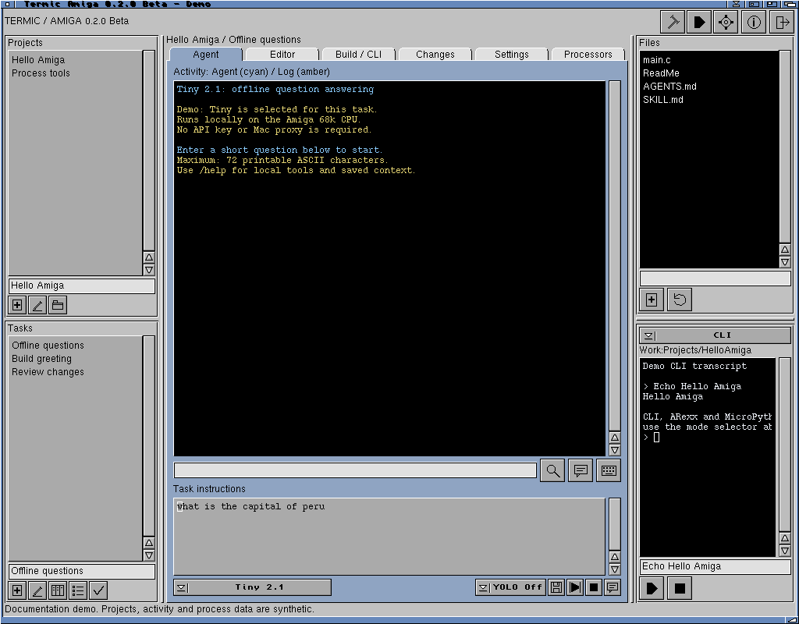
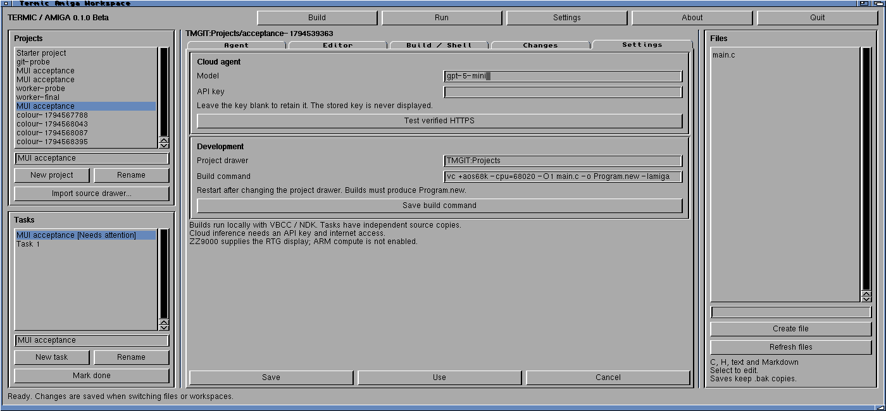
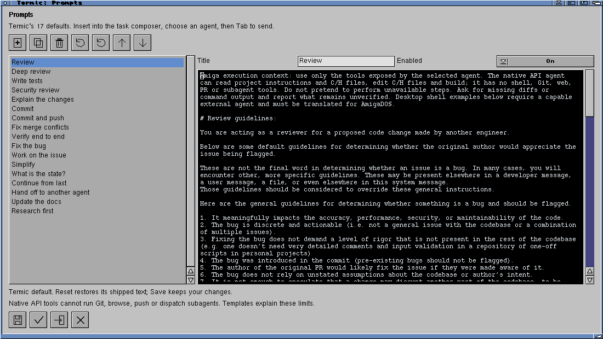
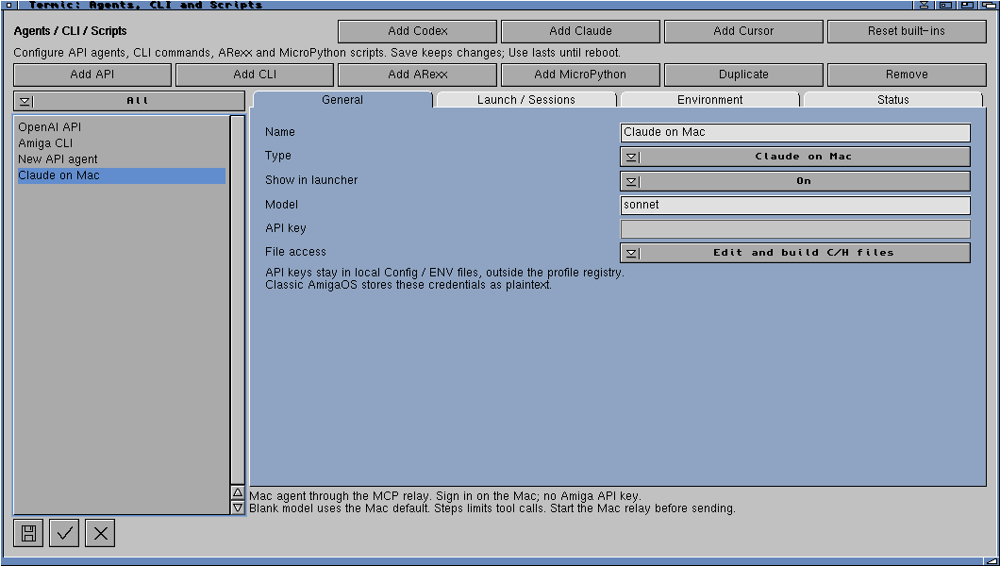
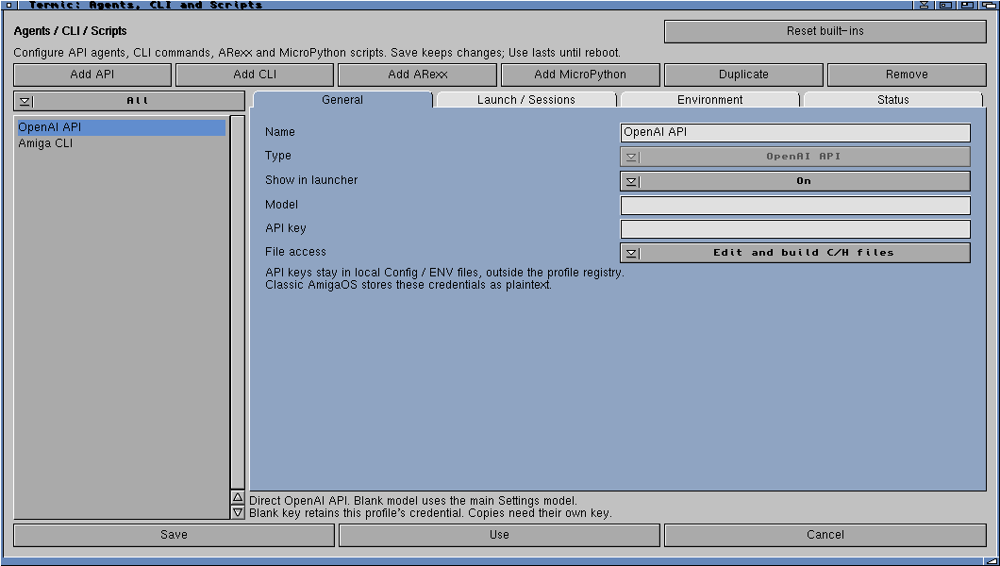
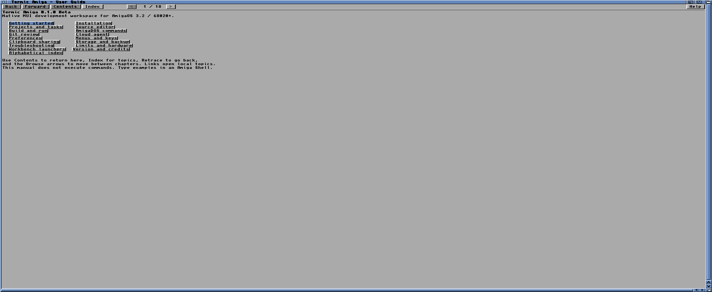

# Termic Amiga

**Native MUI development workspace for AmigaOS. Version 0.1.0 Beta.**

This repository contains the Amiga implementation, separated from the desktop
[Termic project](https://github.com/simion/termic). It runs on the Amiga using
MUI and native 68k tools. It does not require the desktop React/Tauri application.


## Downloads

- [Native Amiga application and SDK kit](https://github.com/SkiltonUSA/Termic-Amiga/releases/download/v0.1.0-beta/Termic-Amiga-0.1.0-beta.lha)
  and [pinned AmiPkg entry](https://github.com/SkiltonUSA/Termic-Amiga/releases/download/v0.1.0-beta/termic-amiga.json).
- [Standalone Process Monitor](https://github.com/SkiltonUSA/Termic-Amiga/releases/download/v0.1.0-beta/Termic-Process-Monitor-0.1.0-beta.lha),
  including source and a Workbench icon.
- AI Proxy for [Apple Silicon macOS](https://github.com/SkiltonUSA/Termic-Amiga/releases/download/v0.1.0-beta/Termic-AI-Proxy-macOS.zip)
  or [Windows 11 x64](https://github.com/SkiltonUSA/Termic-Amiga/releases/download/v0.1.0-beta/Termic-AI-Proxy-Windows11.zip).

Read the installation requirements below before upgrading an existing drawer.
[Release notes and checksums](https://github.com/SkiltonUSA/Termic-Amiga/releases/tag/v0.1.0-beta)
include verification details.

## Features

- Projects and independent source-copy task workspaces.
- Embedded editor with a black background and live C/header, Python and ARexx syntax colours.
- Resolution-scaled blue title bar with close, depth and zoom icons, drag support and a black Files list.
- Source backups, undo/redo, clipboard and search.
- Native VBCC build/run and explicit AmigaDOS commands with captured output.
- Persistent CLI panel below Files, with a resizable half-height split, command entry and job output.
- Native Git initialization, status, diffs, source commits and branch controls.
- Kanban lifecycle board and a persistent serial task queue with failure recovery.
- Agent edit review with accept/revert and task scratchpad notes.
- Clickable compiler diagnostics; host Git worktrees and GitHub PR controls.
- Agent tools for C/header, Python, ARexx and text files, native builds, ARexx/MicroPython/program execution and live hardware queries.
- Codex, Claude and Cursor host profiles, with model selection and live response/tool feedback on the Amiga.
- One black Agent activity pane with cyan responses, amber worker logs and a narrower instruction field beside the controls.
- Standalone Termic AI Proxy desktop app for macOS and Windows 11.
- Agents / CLI / Scripts profiles with separate credentials, launch arguments, sessions and access limits.
- CLI, ARexx and MicroPython script execution, with a pinned native MicroPython runtime.
- Native MCP/CLI routines for task orchestration, builds, source files and scratchpads.
- Editable prompt library with all 17 desktop Termic defaults and Save/Use/Cancel.
- Project-local AGENTS.md and Termic SKILL.md guidance loaded by the API worker.
- Compose, Session and Transcript keyboard reference, with Tab-to-send in the prompt.
- Persistent workspace selection, task status, model settings and an About window.
- Compact action icons with tooltips, native menus and Right-Amiga shortcuts.
- Editor commands in the menu strip, crisp Helvetica/Courier fonts and framed MUI panels.
- Save/Use/Cancel preferences and shared Amiga IFF text clipboard.
- Linked AmigaGuide manual available with Help or Help > Contents... .






See [Prompts, instructions and keyboard shortcuts](docs/prompts-and-instructions.md)
for the prompt library, project guidance and screenshot-style key bindings.




See [Agent execution on the Amiga](docs/agent-execution.md) for the shared
tools, execution results and hardware detection. Cursor collects slow operations
through bounded polling; start a **New conversation** after updating the proxy
and worker to load the revised tools. The proxy now checks task mailboxes
using direct file operations, with bounded retries for read-only bridge
errors. Updated proxy/worker pairs use alternating reply files to reduce
per-message bridge traffic and follow streamed output sooner. See [transport details](docs/codex-relay.md#mailbox-transport).

Start with [Termic AI Proxy for macOS and Windows 11](docs/ai-proxy.md) for
Codex, Claude and Cursor setup, downloads and model selection.
[Codex relay details](docs/codex-relay.md) describe the ChatGPT integration.





See [Agents, CLI, scripts and MCP](docs/agents-and-mcp.md) for setup, client connections
and differences from desktop Termic.




[Amiga interface conventions](docs/amiga-interface.md) describes the menu,
preferences and clipboard behavior and its remaining limitations.

See [Task workflow](docs/task-workflow.md) for the Kanban board, queue, edit review,
notes, compiler locations and Git worktree controls.


## Process Monitor example application

[Termic Process Monitor](amiga/apps/process-monitor/README.md) is a full native
MUI application developed through the Kanban workflow. It lists Exec tasks,
priority, stack capacity, partial tracked allocation and statistical CPU load.
It includes cooperative Stop and opt-in service restart with declared port
dependencies, confirmation, identity checks and bounded waits.

The TF4060 target is detected as a 68060 through Exec. ZZ9000 graphics/shared
RAM boards and an optional ARM debug owner are reported. The installed legacy
firmware does not expose ARM processes or per-process telemetry; the app labels
those values unavailable. It does not reset or replace ARM firmware.


## Requirements and installation

AmigaOS 3.2, 68020 or newer, Fast RAM, MUI 5.0 and TextEditor.mcc 15.56.
The application uses native MUI Title tabs.
Development uses VBCC and NDK3.2. Native Git requires long filenames and was
verified with AmiSSL 5.27. Direct OpenAI HTTPS access additionally needs a
compatible TCP/IP stack, CA certificates, an accurate clock and your own API key.
Host CLI profiles use their existing Mac/Windows login through the AI Proxy.

Press **Help** for the [AmigaGuide manual](amiga/native/Termic.guide), with linked
chapters, an index and optional ToolsDaemon Workbench launcher instructions.
Install `Termic.guide` beside `TermicNative`; it opens in MultiView.
**Shift-Help** opens About. MagicMenu and ToolsDaemon are optional and unbundled.



See the [native installation guide](amiga/native/ReadMe) for installation layout,
SDK setup, builds, project storage, shortcuts and limits. Dependency archives
are pinned by SHA-256 in [sdk-lock.json](amiga/native/sdk-lock.json).
See [AmiPkg release building and validation](docs/amipkg-release.md) for the
installation recipe, dependency checks and fresh-install safeguards.
The entry is not yet part of the public AmiPkg catalog.

## Build and verification

`amiga/native/BuildNative` builds TermicNative, TermicAgent, TermicStorage, TermicMCP and TermicCheck
on the Amiga in the installation layout described in the guide. Their shared
version is defined in [version.h](amiga/native/version.h), independently of the
desktop version. All five support `--version` and AmigaDOS `Version FILE FULL`.

Run portable tests on a host with a C compiler and AddressSanitizer:

```sh
python3 -m unittest discover -s scripts/amiga -p 'test_*.py'
```

The opt-in `accept_chrome.py` checks the current custom window controls through
an already-running DevBench MCP server. Compile `amiga/native/tests/inspect_chrome.c`
with the Amiga compiler and `-lamiga`, then supply that helper with `--probe`.
It expects the 1920x800 acceptance desktop and a 1400x650 Termic candidate.
Keep the bridge window beneath Termic's upper-left corner for the depth check.
Use `--close-at-end` to include the close-button check. It uses injected mouse
input; do not run it while someone is using the Amiga.

The earlier `accept_mui.py`, `accept_colours.py`, `accept_about.py` and
`accept_style.py` preserve the native-title acceptance workflows. Their window
name guards target the earlier native title bar and require adaptation before
use with the current borderless window; do not bypass those guards.

`accept_agents.py --cli-panel-only`, with its required binary arguments, checks
CLI command entry, success/failure output, editor focus, copy, save/undo and
window resizing in an isolated Amiga installation. It restores the production
settings and clipboard afterward and requires no cloud credentials.
`--live-feedback-only` checks incremental transcript display before completion,
clipboard selection during updates, combined worker logs, tool start/return markers,
completion, cancellation and clearing the previous run's log. Compile
`amiga/native/tests/inspect_ui.c` with the Amiga compiler and `-lamiga` to
`.context/inspect-ui` for its clipboard checks. Stop the AI Proxy before
running hardware acceptance, then restart it after production is restored.
`amiga/native/tests/test_texteditor_stream.c` is an additional native MUI
regression for preserving text across streamed chunk boundaries.
`amiga/native/tests/test_activity_scroll.c` checks following the final line
on the installed MUI/TextEditor classes. Compile it with the same SDK
headers and `-lamiga`, then run `accept_activity_scroll.py --binary <probe>`
with AI Proxy stopped. It uses synthetic text and leaves production tasks
and settings untouched.

[Verification and limitations](docs/verification.md) distinguishes tested
behavior from functionality still awaiting hardware or authenticated checks.

## Scope

Tasks are independent source snapshots, not Git worktrees. The shell captures
commands; it is not an interactive PTY. Desktop agent CLIs run on the host through the proxy.
The serial queue and host worktree/PR controls are described above.
Broadcast/race modes are not implemented.
ZZ9000 supplies the existing RTG display; ARM compute offload is not implemented.

## Credits and licence

Amiga adaptation: Dominic Skilton, with Codex assistance.
Original Termic: Simion Agavriloaei and contributors.
Development uses MUI, TextEditor.mcc, VBCC, vasm, vlink, NDK, AmiSSL, cJSON,
native Git and the [Amiga MCP bridge](https://github.com/geekychris/amiga_mcp).

Termic is licensed under the [GNU AGPL](LICENSE), version 3 or later.
Third-party components retain their own licences and notices.
This snapshot derives from the native Amiga work at
[commit 30562586](https://github.com/SkiltonUSA/termic/commit/30562586).
