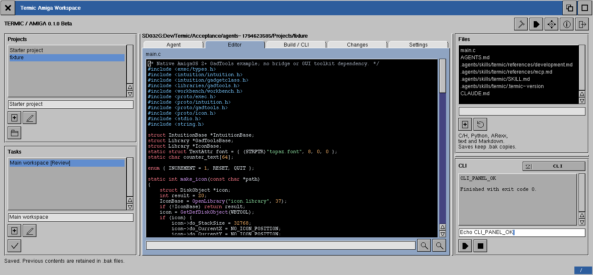
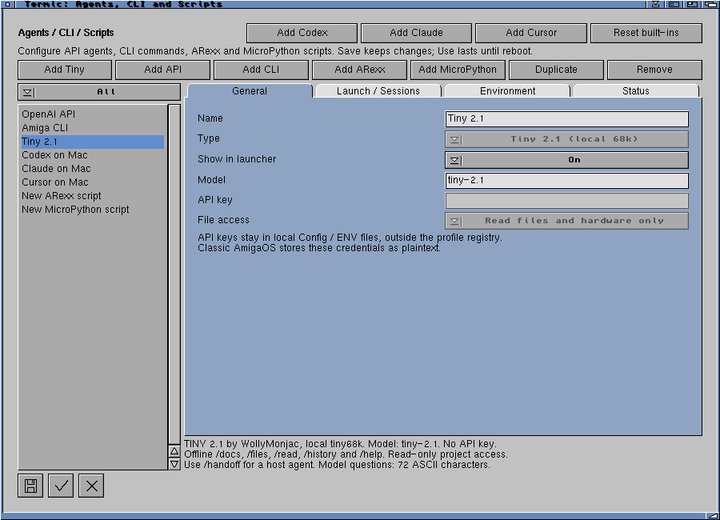
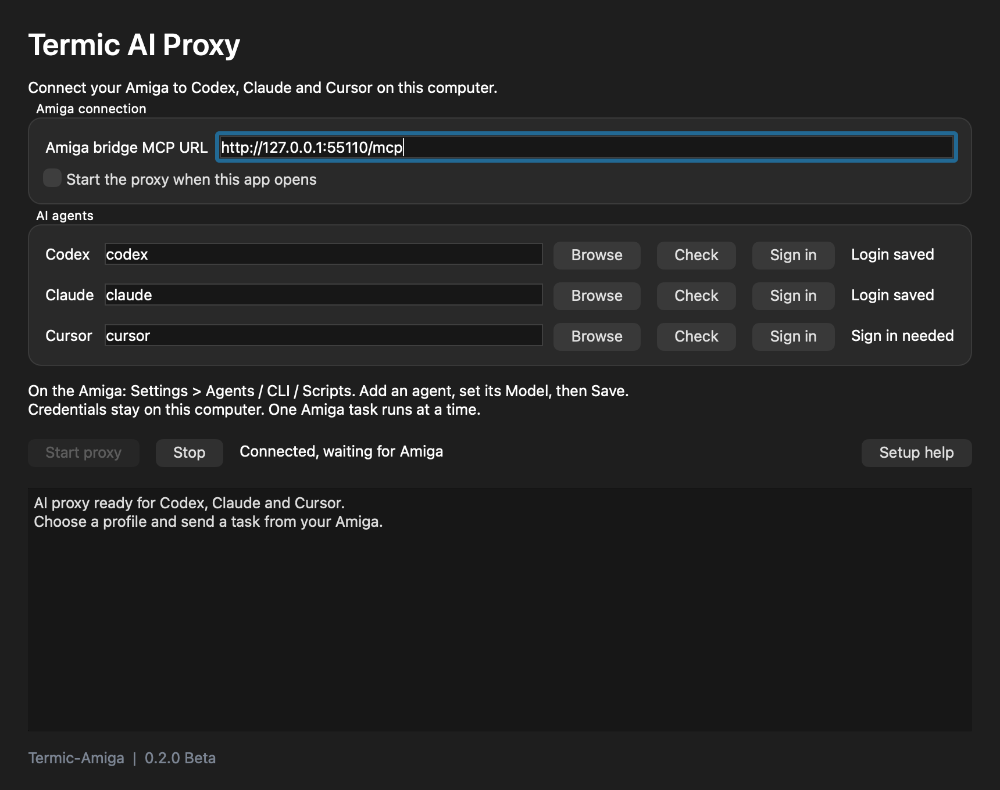

# Termic Amiga

**Native MUI development workspace for AmigaOS. Version 0.2.1 Beta.**

Termic runs on the Amiga using MUI 5 and native 68k tools. It includes an
editable code workspace, CLI console, offline Tiny assistant and Processors
panel. Cloud-agent access uses the separately downloadable Mac or Windows AI Proxy.



Captured on the Amiga using the production MUI widgets and synthetic
demonstration data. [More screenshots and capture details](docs/screenshots.md).
The Amiga screenshots show the 0.2.0 development build with the contrast and
Guide improvements now included in 0.2.1 Beta.

## Downloads

| Download | Where it runs | Purpose |
| --- | --- | --- |
| [Termic Amiga 0.2.1 Beta LHA](https://github.com/SkiltonUSA/Termic-Amiga/releases/download/v0.2.1-beta/Termic-Amiga-0.2.1-beta.lha) | AmigaOS 3.2, 68020+ | Application, source, offline Tiny, MicroPython and SDK kit. |
| [AmiPkg entry](https://github.com/SkiltonUSA/Termic-Amiga/releases/download/v0.2.1-beta/termic-amiga.json) | Amiga | Pinned fresh-install recipe and dependency requirements. |
| [Termic AI Proxy for Mac](https://github.com/SkiltonUSA/Termic-Amiga/releases/download/v0.2.1-beta/Termic-AI-Proxy-macOS.zip) | Apple Silicon macOS | Standalone 0.2.0 Beta app for Codex, Claude and Cursor. |
| [Termic AI Proxy for Windows](https://github.com/SkiltonUSA/Termic-Amiga/releases/download/v0.2.1-beta/Termic-AI-Proxy-Windows.zip) | Windows 11 x64 | Portable 0.2.0 Beta app with Python/Qt included. Extract the complete folder and open Termic AI Proxy.exe. |
| [Amiga-MCP multi-client bridge](https://github.com/SkiltonUSA/Termic-Amiga/releases/download/v0.2.1-beta/Amiga-MCP-MultiClient-macOS-arm64.zip) | Apple Silicon macOS | Shared gateway with up to 64 MCP sessions and a 32-request queue. |
| [Optional standalone Process Monitor](https://github.com/SkiltonUSA/Termic-Amiga/releases/download/v0.2.1-beta/Termic-Process-Monitor-0.2.1-beta.lha) | Amiga | Process tools outside the integrated Termic window. |
| [SHA-256 checksums](https://github.com/SkiltonUSA/Termic-Amiga/releases/download/v0.2.1-beta/SHA256SUMS) | Host | Verify every download. |

The Mac and Windows Proxy packages include their Python runtimes. The Amiga-MCP gateway is the
multi-client upstream build, version 0.1.0 Alpha, packaged separately from
Termic. It needs an existing connected DevBench backend on port 55010 and
starts paused. Clients connect to the gateway on port 55110. See
[bridge setup and validation](docs/amiga-mcp-package.md).

MUI 5 must already be installed. The AmiPkg recipe requires a fresh drawer
and declares TextEditor.mcc 15.56 and AmiSSL 5.27 dependencies. For existing
installations, use the [upgrade instructions](docs/amipkg-release.md) to preserve
projects, preferences, task memory and credentials.

[0.2.1 Beta release notes](https://github.com/SkiltonUSA/Termic-Amiga/releases/tag/v0.2.1-beta)
record verification and installation limits. Older release downloads are
retained as maintainer-only drafts; historical source tags remain public.
PNG screenshots are not release assets or installed files. See the
[release policy](docs/releases.md).

## Included in 0.2.1 Beta

- Native colour Workbench launcher and `Termic-Amiga` installation drawer.
- Readable shared-palette text on black, orange Guide links and single-list contents.
- Separate Windows Proxy download, promoted from the tested Windows CI build.
- Black editable CLI console with inline Return submission and a separate
  input field. Commands run in the selected project/task directory and drafts
  survive log and history updates.
- Clear, aligned preference Save buttons and native MUI 5 help.
- [Offline Tiny tools](docs/tiny.md): guide search, read-only project access,
  task memory and explicit handoff to configured cloud agents.
- [Host recovery](docs/bridge-recovery.md): per-run tokens, explicit resume,
  process locks, bounded operations and verified cleanup.
- Separate Mac AI Proxy and multi-client gateway packages, tested against
  synthetic MCP backends without touching the live Amiga.

The bundled Tiny model is the original pinned Tiny 2.1 model. Experimental
training material remains in source; older experimental downloads are archived.
The complete release package has host validation; physical installation of
this exact version still requires target acceptance.


## Workbench and Guide

The Workbench launcher is named **Termic Amiga**, inside **Termic-Amiga**.
On the development Amiga the drawer is `SD032G:Termic-Amiga`. The launcher
uses a frameless colour icon with an Amiga checker-ball badge and a distinct
selected state. It finds the application beside itself without requiring an existing `Termic:`
assign. `BuildNative` creates the launcher and its native `.info` icon;
`"Termic:Termic Amiga" --make-icons` regenerates the tool and drawer icons.

Shared palette colours keep editor, CLI, activity and Guide text readable when
Workbench has no free exclusive colour pens. Guide links are orange, with
Contents arranged as one vertical list. These changes were verified on the
development Amiga and are included in the 0.2.1 Beta archive. The exact fresh-install recipe still needs target acceptance.



## Features

- Projects and independent source-copy task workspaces.
- Embedded editor with a black background and live C/header, Python and ARexx syntax colours.
- Native MUI 5 window controls and responsive compact/wide layouts, with a black Files list.
- Projects/Tasks left, tabbed workspace centre, Files/CLI right; compact panes at 340x280.
- Source backups, undo/redo, clipboard and search.
- Native VBCC build/run and explicit AmigaDOS commands with captured output.
- Persistent CLI panel below Files, with a resizable half-height split and a black editable console. Type after `>` and press Return, or use the separate command field; unfinished inline commands survive output updates. Commands start in the selected project/task directory, displayed beneath the mode selector.
- Native Git initialization, status, diffs, source commits and branch controls.
- Integrated Process Monitor with native column dividers, CPU/memory sorting and pause/resume.
- Optional ZZ9000 information button, hidden by default; no ARM compute offload is enabled.
- Kanban drag-and-drop and a persistent queue with up to four independent workers; host relay requests stay serial.
- Coloured unified change review with whole-file accept/revert, plus task scratchpad notes.
- Broadcast instructions to selected agent profiles using independent task copies.
- Clickable compiler diagnostics; host Git worktrees and GitHub PR controls.
- Agent tools for C/header, Python, ARexx and text files, native builds, ARexx/MicroPython/program execution and live hardware queries.
- Codex, Claude and Cursor host profiles, with model selection and live response/tool feedback on the Amiga.
- One black Agent activity pane with cyan responses, amber worker logs and task instructions above a single row of agent controls.
- Standalone Termic AI Proxy desktop app for macOS and Windows 11.
- Agents / CLI / Scripts profiles with separate credentials, launch arguments, sessions and access limits.
- CLI, ARexx and MicroPython script execution, with a pinned native MicroPython runtime.
- Native MCP/CLI routines for task orchestration, builds, source files and scratchpads.
- Editable prompt library with all 17 desktop Termic defaults and Save/Use/Cancel.
- Project-local AGENTS.md and Termic SKILL.md guidance loaded by the API worker.
- Configurable prompt/transcript shortcuts with conflict checks, Defaults and Save/Use/Cancel.
- Persistent workspace selection, task status, model settings and an About window.
- Compact action icons with tooltips, single-row Projects/Tasks controls, native menus and Right-Amiga shortcuts.
- Editor commands in the menu strip, crisp Helvetica/Courier fonts and native framed panels.
- Save/Use/Cancel preferences and shared Amiga IFF text clipboard.
- Native MUI 5 help window with chapter navigation, related topics, history and search.

See [Prompts, instructions and keyboard shortcuts](docs/prompts-and-instructions.md)
for the prompt library, project guidance and screenshot-style key bindings.

Shortcut preferences support Assign, Defaults, Save, Use and Cancel.

See [Agent execution on the Amiga](docs/agent-execution.md) for the shared
tools, execution results and hardware detection. Cursor collects slow operations
through bounded polling; start a **New conversation** after updating the proxy
and worker to load the revised tools. The proxy now checks task mailboxes
using direct file operations, with bounded retries for read-only bridge
errors. Updated proxy/worker pairs use alternating reply files to reduce
per-message bridge traffic and follow streamed output sooner. See [transport details](docs/codex-relay.md#mailbox-transport).

The latest source also verifies mailbox reads by filename, CRC32 and length,
and recovers lost acknowledgements without repeating builds or executions.
A real Codex task passed native generation, compilation, execution, review and
Kanban completion on the A4000TX. These proxy changes are available in the
[desktop build workflow](https://github.com/SkiltonUSA/Termic-Amiga/actions/workflows/ai-proxy.yml);
the current Mac and Windows proxy downloads include them. See
[verification](docs/verification.md#proxy-reliability-and-real-agent-workflow-15-november-2026)
for the tested scope.

Start with [Termic AI Proxy for macOS and Windows 11](docs/ai-proxy.md) for
Codex, Claude and Cursor setup, downloads and model selection.
[Codex relay details](docs/codex-relay.md) describe the ChatGPT integration.



See [Agents, CLI, scripts and MCP](docs/agents-and-mcp.md) for setup, client connections
and differences from desktop Termic.

[Amiga interface conventions](docs/amiga-interface.md) describes the menu,
preferences and clipboard behavior and its remaining limitations.

See [Task workflow](docs/task-workflow.md) for the Kanban board, queue, edit review,
notes, compiler locations and Git worktree controls.

See [task workflow](docs/task-workflow.md) for broadcast instructions and the parallel worker queue.

## Integrated Process Monitor

[Termic Process Monitor](amiga/apps/process-monitor/README.md) opens inside Termic
from **Tools > Process Monitor...** or **Right Amiga I**. **F4** opens it while
the agent prompt has focus. It is also available as a standalone MUI application,
developed through the Kanban workflow. It lists Exec tasks,
priority, stack capacity, partial tracked allocation and statistical CPU load.
It includes cooperative Stop and opt-in service restart with declared port
dependencies, confirmation, identity checks and bounded waits.

The process table has native column separators and aligned headings. CPU and
Memory sort descending; Name sorts alphabetically. Pause stops sampling.
The **ZZ9000...** button shows optional board/ARM information; **Hide ZZ9000**
returns that space to the process list. Board queries stop while the panel is
hidden. This button does not enable ARM compute offload.

The TF4060 target is detected as a 68060 through Exec. ZZ9000 graphics/shared
RAM boards and an optional ARM debug owner are reported. The installed legacy
firmware does not expose ARM processes or per-process telemetry; the app labels
those values unavailable. It does not reset or replace ARM firmware.


## Requirements and installation

AmigaOS 3.2, 68020 or newer, Fast RAM, MUI 5.0 and TextEditor.mcc 15.56.
The application uses native MUI Title tabs.
Development uses VBCC and NDK3.2. Native Git requires long filenames and was
verified with AmiSSL 5.27. Direct OpenAI HTTPS access additionally needs a
compatible TCP/IP stack, CA certificates, an accurate clock and your own API key.
Host CLI profiles use their existing Mac/Windows login through the AI Proxy.

Press **Help** for the [AmigaGuide manual](amiga/native/Termic.guide), with linked
chapters, an index and optional ToolsDaemon Workbench launcher instructions.
Install `Termic.guide` beside `TermicNative`. The current source opens it inside
Termic in a native MUI 5 help window. Contents, Index, Back, chapter navigation,
related topics and search are built in. MultiView remains an optional external viewer.
**Shift-Help** opens About. MagicMenu and ToolsDaemon are optional and unbundled.

See the [native installation guide](amiga/native/ReadMe) for installation layout,
SDK setup, builds, project storage, shortcuts and limits. Dependency archives
are pinned by SHA-256 in [sdk-lock.json](amiga/native/sdk-lock.json).
See [AmiPkg release building and validation](docs/amipkg-release.md) for the
installation recipe, dependency checks and fresh-install safeguards.
The entry is not yet part of the public AmiPkg catalog.

## Build and verification

`amiga/native/BuildNative` builds TermicNative, TermicAgent, TermicStorage, TermicMCP and TermicCheck
on the Amiga in the installation layout described in the guide. Their shared
version is defined in [version.h](amiga/native/version.h), independently of the
desktop version. All five support `--version` and AmigaDOS `Version FILE FULL`.

Run portable tests on a host with a C compiler and AddressSanitizer:

```sh
python3 -m unittest discover -s scripts/amiga -p 'test_*.py'
```

`accept_responsive_ui.py` checks the native MUI size/page matrix, unsaved
buffer and cursor preservation, small auxiliary windows and synthetic captures.
Compile `tests/test_responsive_window.c` with the GUI dependencies and the
`amiga/apps/process-monitor` include directory; pass it with `--binary`,
`inspect_chrome.c` with `--probe`, and a fresh `--output` directory.
The normal workspace can remain open. The older `accept_chrome.py` targets the
retired custom title bar and is not a test of the current layout.

`accept_agents.py --editor-workflow-only` exercises the actual workspace
through native mouse and keyboard input: save, build, run, compiler failure
recovery and CLI output at 1024x800 and 340x280. It temporarily closes the
normal workspace and restores its preferences, clipboard and geometry. Stop
the AI Proxy and leave the mouse/keyboard idle during the test. See
[verification instructions](docs/verification.md#live-mui-development-workflow-16-november-2026).

`accept_gallery.py --only cli-editable.png` verifies the editable console using
production MUI widgets and a synthetic Acceptance drawer: inline Return routing,
worker execution, separate-field submission, draft preservation during output,
and rejection of edited history or multiline input. Compile
`tests/test_gallery_window.c` with the GUI units and pass `--binary`, `--probe`
and a new `--output` directory. It captures only synthetic data.

`accept_agents.py --cli-panel-only`, with its required binary arguments, checks
CLI command entry, success/failure output, editor focus, copy, save/undo and
window resizing in an isolated Amiga installation. It restores the production
settings and clipboard afterward and requires no cloud credentials.
`--live-feedback-only` checks incremental transcript display before completion,
clipboard selection during updates, combined worker logs, tool start/return markers,
completion, cancellation and clearing the previous run's log. Compile
`amiga/native/tests/inspect_ui.c` with the Amiga compiler and `-lamiga` to
`.context/inspect-ui` for its clipboard checks. Stop the AI Proxy before
running hardware acceptance, then restart it after production is restored.
`amiga/native/tests/test_texteditor_stream.c` is an additional native MUI
regression for preserving text across streamed chunk boundaries.
`amiga/native/tests/test_activity_scroll.c` checks following the final line
on the installed MUI/TextEditor classes. Compile it with the same SDK
headers and `-lamiga`, then run `accept_activity_scroll.py --binary <probe>`
with AI Proxy stopped. It uses synthetic text and leaves production tasks
and settings untouched.

`accept_workflow_ui.py` exercises native drag-and-drop, configurable shortcuts,
broadcast source copies and overlapping builds in isolated Acceptance tasks.
It requires the compiled `test_workflow_window.c`, `input_gesture.c` and
`inspect_chrome.c` helpers, the installed compiler/worker, and an idle AI Proxy.
The normal Termic window can remain open. Captures use synthetic data and the
MCP screenshot method; the suite rejects incomplete image transfers.

[Verification and limitations](docs/verification.md) distinguishes tested
behavior from functionality still awaiting hardware or authenticated checks.

## Scope

Tasks are independent source snapshots, not Git worktrees. The shell captures
commands; it is not an interactive PTY. Desktop agent CLIs run on the host through the proxy.
The queue supports independent workers and broadcast task copies. Host proxy
requests remain serial; race mode is not implemented.
ZZ9000 supplies the existing RTG display; ARM compute offload is not implemented.

## Credits and licence

Amiga adaptation: Dominic Skilton, with Codex assistance.
Original Termic: Simion Agavriloaei and contributors.
Development uses MUI, TextEditor.mcc, VBCC, vasm, vlink, NDK, AmiSSL, cJSON,
native Git and the [Amiga MCP bridge](https://github.com/geekychris/amiga_mcp).

Termic is licensed under the [GNU AGPL](LICENSE), version 3 or later.
Third-party components retain their own licences and notices.
This snapshot derives from the native Amiga work at
[commit 30562586](https://github.com/SkiltonUSA/termic/commit/30562586).
