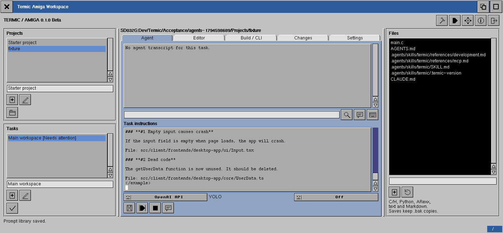
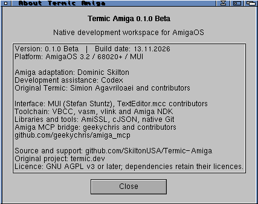
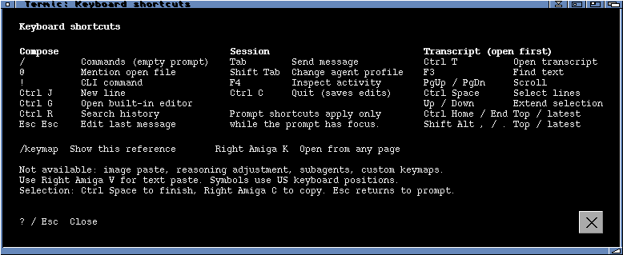
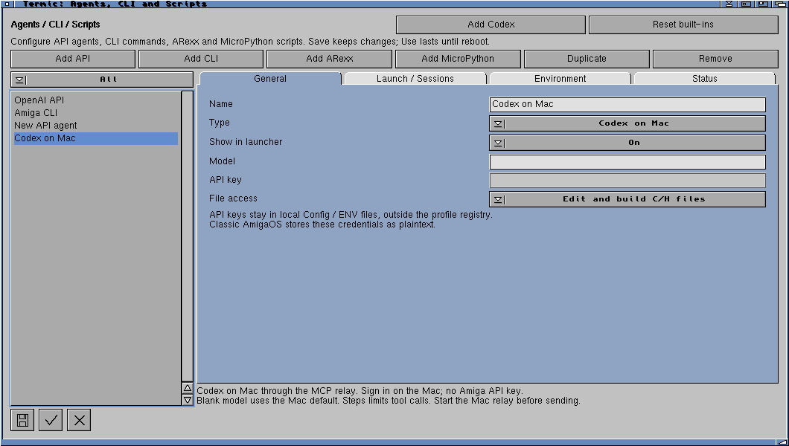
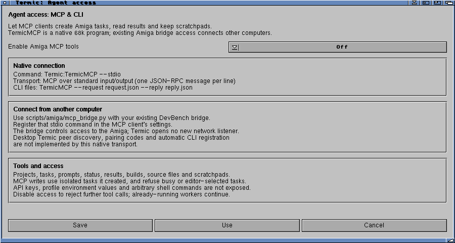

# Termic Amiga

**Native MUI development workspace for AmigaOS. Version 0.1.0 Beta.**

This repository contains the Amiga implementation, separated from the desktop
[Termic project](https://github.com/simion/termic). It runs on the Amiga using
MUI and native 68k tools. It does not require the desktop React/Tauri application.



## Features

- Projects and independent source-copy task workspaces.
- Embedded editor with a black background and C/header syntax colours on load.
- Resolution-scaled blue title bar with close, depth and zoom icons, drag support and a black Files list.
- Source backups, undo/redo, clipboard and search.
- Native VBCC build/run and explicit AmigaDOS commands with captured output.
- Native Git initialization, status, diffs and source commits.
- OpenAI agent conversations with bounded C/header file tools and local builds.
- Codex on Mac relay using ChatGPT sign-in, with prompts sent from the Amiga.
- Agents / CLI / Scripts profiles with separate credentials, launch arguments, sessions and access limits.
- CLI, ARexx and MicroPython script execution, with a pinned native MicroPython runtime.
- Native MCP/CLI routines for task orchestration, builds, source files and scratchpads.
- Editable prompt library with all 17 desktop Termic defaults and Save/Use/Cancel.
- Project-local AGENTS.md and Termic SKILL.md guidance loaded by the API worker.
- Compose, Session and Transcript keyboard reference, with Tab-to-send in the prompt.
- Persistent workspace selection, task status, model settings and an About window.
- Compact action icons with tooltips, native menus and Right-Amiga shortcuts.
- Editor commands in the menu strip, crisp Helvetica/Courier fonts and framed MUI panels.
- Save/Use/Cancel preferences and shared Amiga IFF text clipboard.
- Linked AmigaGuide manual available with Help or Help > Contents... .




See [Prompts, instructions and keyboard shortcuts](docs/prompts-and-instructions.md)
for the prompt library, project guidance and screenshot-style key bindings.




For ChatGPT sign-in without an Amiga API key, see [Codex on Mac relay](docs/codex-relay.md).



See [Agents, CLI, scripts and MCP](docs/agents-and-mcp.md) for setup, client connections
and differences from desktop Termic.




[Amiga interface conventions](docs/amiga-interface.md) describes the menu,
preferences and clipboard behavior and its remaining limitations.

## Requirements and installation

AmigaOS 3.2, 68020 or newer, Fast RAM, MUI 3.8+ and TextEditor.mcc 15.56.
The application is also tested with MUI 5.0 and uses its native Title tabs.
Development uses VBCC and NDK3.2. Native Git requires long filenames and was
verified with AmiSSL 5.27. Cloud access additionally needs a compatible TCP/IP
stack, CA certificates, an accurate clock and your own OpenAI API key.

Press **Help** for the [AmigaGuide manual](amiga/native/Termic.guide), with linked
chapters, an index and optional ToolsDaemon Workbench launcher instructions.
Install `Termic.guide` beside `TermicNative`; it opens in MultiView.
**Shift-Help** opens About. MagicMenu and ToolsDaemon are optional and unbundled.


See the [native installation guide](amiga/native/ReadMe) for installation layout,
SDK setup, builds, project storage, shortcuts and limits. Dependency archives
are pinned by SHA-256 in [sdk-lock.json](amiga/native/sdk-lock.json).
The source is backed up here; an AmiPkg release has not yet been published.

## Build and verification

`amiga/native/BuildNative` builds TermicNative, TermicAgent, TermicStorage and TermicMCP
on the Amiga in the installation layout described in the guide. Their shared
version is defined in [version.h](amiga/native/version.h), independently of the
desktop version. All four support `--version` and AmigaDOS `Version FILE FULL`.

Run portable tests on a host with a C compiler and AddressSanitizer:

```sh
python3 -m unittest discover -s scripts/amiga -p 'test_*.py'
```

The opt-in `accept_chrome.py` checks the current custom window controls through
an already-running DevBench MCP server. Compile `amiga/native/tests/inspect_chrome.c`
with the Amiga compiler and `-lamiga`, then supply that helper with `--probe`.
It expects the 1920x800 acceptance desktop and a 1400x650 Termic candidate.
Keep the bridge window beneath Termic's upper-left corner for the depth check.
Use `--close-at-end` to include the close-button check. It uses injected mouse
input; do not run it while someone is using the Amiga.

The earlier `accept_mui.py`, `accept_colours.py`, `accept_about.py` and
`accept_style.py` preserve the native-title acceptance workflows. Their window
name guards target the earlier native title bar and require adaptation before
use with the current borderless window; do not bypass those guards.

[Verification and limitations](docs/verification.md) distinguishes tested
behavior from functionality still awaiting hardware or authenticated checks.

## Scope

Tasks are independent source snapshots, not Git worktrees. The shell captures
commands; it is not an interactive PTY. Desktop agent CLIs, streamed tokens,
queue/broadcast/race modes and integrated remote PR controls are not implemented.
ZZ9000 supplies the existing RTG display; ARM compute offload is not implemented.

## Credits and licence

Amiga adaptation: Dominic Skilton, with Codex assistance.
Original Termic: Simion Agavriloaei and contributors.
Development uses MUI, TextEditor.mcc, VBCC, vasm, vlink, NDK, AmiSSL, cJSON,
native Git and the [Amiga MCP bridge](https://github.com/geekychris/amiga_mcp).

Termic is licensed under the [GNU AGPL](LICENSE), version 3 or later.
Third-party components retain their own licences and notices.
This snapshot derives from the native Amiga work at
[commit 30562586](https://github.com/SkiltonUSA/termic/commit/30562586).
