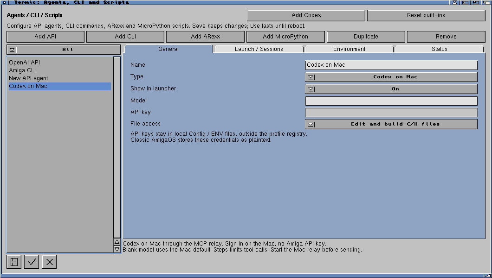

# Codex on Mac, controlled from Termic Amiga

The **Codex on Mac** profile sends the Amiga task composer to a local Mac relay.
Codex uses its ChatGPT sign-in on the Mac. Source reads, edits and compilation
execute on the Amiga through the existing DevBench MCP bridge. No API key or
ChatGPT access/refresh token is sent to the Amiga.



For the standalone desktop application and Claude/Cursor support, see
[Termic AI Proxy](ai-proxy.md). The command-line launcher below is optional.

## Install and start

On the Mac, install Codex CLI and sign in with `codex login`. Then, from this
repository:

```sh
python3 scripts/amiga/install_codex_relay.py
```

The installer creates a private Python environment with MCP 1.30.0 and copies
the relay scripts into `~/Library/Application Support/Termic-Amiga/relay`.
It creates `~/Applications/Termic Amiga Codex.command`. Double-click that launcher
and leave its Terminal window open. Ctrl C stops the relay. It does not modify
login items, system startup or your normal Codex configuration.

The existing DevBench bridge must already be running at
`http://127.0.0.1:55010/mcp`. For a different address, run the script with
`--bridge URL`. File transfers use MCP operations directly, without a shared
filesystem. No second DevBench bridge is started. Claude/Cursor tasks use a
private authenticated loopback adapter described in the proxy documentation.

On the Amiga:

1. Open **Settings > Agents / CLI / Scripts**, or press Right Amiga E.
2. Select **Add Codex**. Keep the model blank to use Codex's default, or enter a
   model available to your account. Choose read-only or edit-and-build access.
3. Save the profile, then select **Codex on Mac** beneath the task composer.
4. Enter a task and press Tab or the Start Agent icon.

Responses and tool progress appear in the transcript. Build / CLI shows worker
status. Stop (Shift F10) requests cancellation. New conversation discards the
selected profile's local thread reference; it retains the transcript. After
changing a profile's file-access mode, start a new conversation to refresh
Codex's advertised tool list. The native worker enforces the current mode
even for an older conversation.

The separate **Agent access / MCP** setting controls external TermicMCP callers.
A user-initiated relay worker does not require that setting to be enabled.

## Connection and scope

```text
Amiga composer -> native TermicAgent mailbox
                         |
                existing DevBench MCP
                         |
                Mac relay -> Codex app-server -> OpenAI
                         |
              bounded tool requests back to TermicAgent
```

Codex app-server speaks its own JSON-RPC protocol, not MCP. The relay uses its
experimental dynamic-tool interface and the existing MCP transport to the
Amiga. It does not use the removed `codex mcp-server` command. This integration
was developed against Codex CLI 0.166.0; recheck it when upgrading Codex.

Six tools are exposed: list_sources, read_source, read_file, write_source,
write_file and build. These reuse the native API agent's path checks and backup
saves. Reads include the six named project guidance files; writes are C/H only,
up to 32 KiB. Read-only mode also disables builds. The worker owns the selected
task's busy lock while tools run, preventing GUI edits from racing agent writes.
The model never receives the general-purpose DevBench bridge tools.

Local Mac execution environments, shell tools, apps, browser tools and subagents
are disabled for relay conversations. Additional permission requests are
rejected. Native builds still execute the task's configured AmigaDOS build
command with ordinary AmigaOS permissions, just as the existing native API
agent does. This is not an operating-system sandbox on the Amiga.

Project AGENTS.md and SKILL.md are included on each turn, bounded to 8 KiB each.
Conversation IDs are saved per task/profile and resumed on the Mac. The relay
uses its own Codex home/history directory and a local link to the existing
file-based Codex sign-in. It does not read or print the token contents. If the
Mac uses a keychain-only sign-in, sign into the isolated Codex home separately;
the installer reports that a file-based sign-in was not found.

Only one relay task runs at a time. Requests use a unique job ID and increasing
sequence numbers; stale or repeated frames cannot repeat a tool operation.
The Amiga waits up to 60 seconds for the initial connection and 120 seconds
between operations. The Mac sends keepalives while Codex works. A turn has a
25-minute Mac limit and a 30-minute native wait-loop limit, excluding time spent
inside synchronous native tool calls. An interrupted build may take time to
return from the native compiler before cancellation is observed.

If the relay stops or the bridge disconnects, the worker fails with a visible
status and preserves source backups. Restart the relay and send again; it does
not automatically replay a failed task. A stale conversation that cannot resume
needs **New conversation**. There is no automatic fallback to a different model
or a new conversation.

Mailbox JSON frames are limited to 64 KiB, including escaped tool arguments.
Transcript updates use backup-and-replace writes and close the file between
messages so the GUI can read progress. The transcript limit is 256 KiB; archive
a full transcript before continuing. It is never silently truncated.

Completed assistant messages are forwarded as plain ASCII text, rather than
individual streamed tokens. Unsupported characters are replaced for the classic
TextEditor widget. The API output-token and usage-reporting controls are disabled
for this profile. **API steps / relay calls** bounds its tool calls (1–32); it is
not a subscription quota or a model-token budget. YOLO and CLI arguments do not
apply. ChatGPT account entitlements and usage limits still apply.

## Checks

`codex_relay.py --check` verifies ChatGPT authentication without model inference.
Portable tests cover mailbox ordering, stopped jobs, request validation,
read-only tool exposure, native replay rejection, tool-call limits, conversation
IDs, completion and local credential linking. The opt-in hardware test is:

```sh
python scripts/amiga/accept_agents.py --gui /path/to/TermicNative \
  --worker /path/to/TermicAgent --mcp /path/to/TermicMCP \
  --probe /path/to/ChromeProbe --micropython /path/to/micropython --codex-relay
```

It uses the signed-in ChatGPT account for synthetic test prompts. It closes
production normally, uses an isolated Amiga installation, preserves the clipboard
on the Amiga, and restores ENV settings, assigns and window geometry afterward.
Do not use the Amiga mouse/keyboard while the written UI suite runs.

Official references: [Codex authentication](https://learn.chatgpt.com/docs/auth),
[app-server protocol](https://learn.chatgpt.com/docs/app-server), and
[Codex MCP server removal](https://learn.chatgpt.com/docs/mcp-server).
