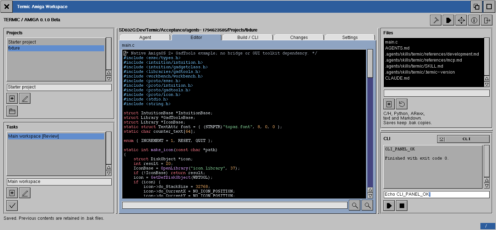
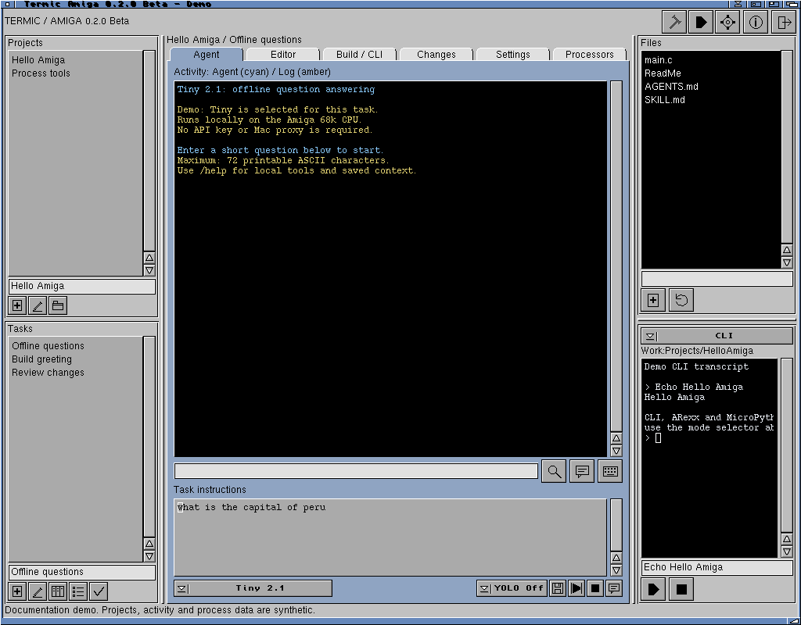
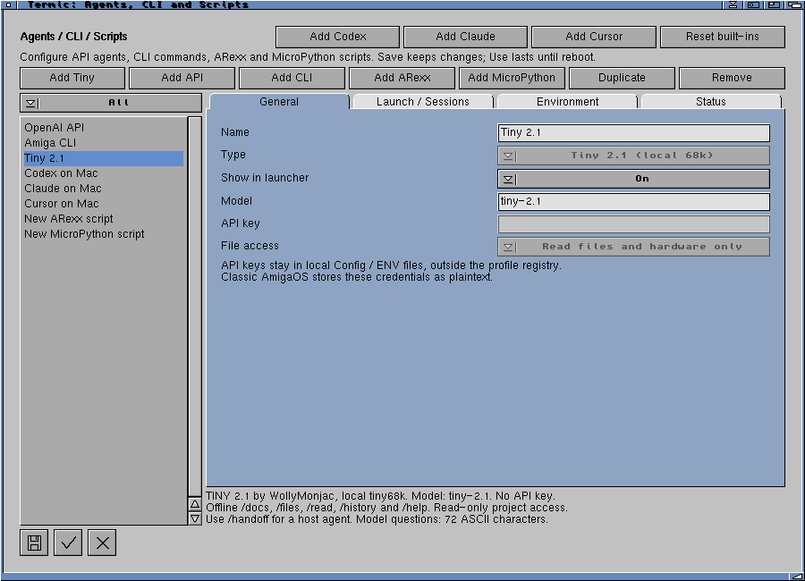
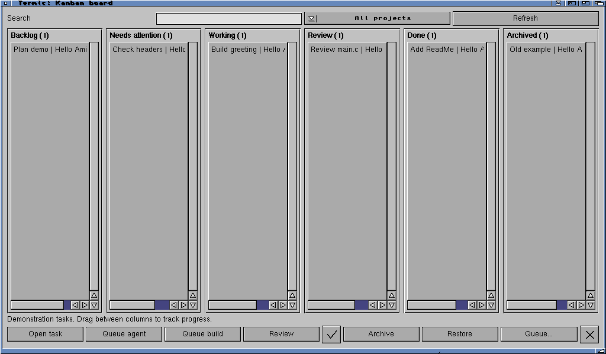
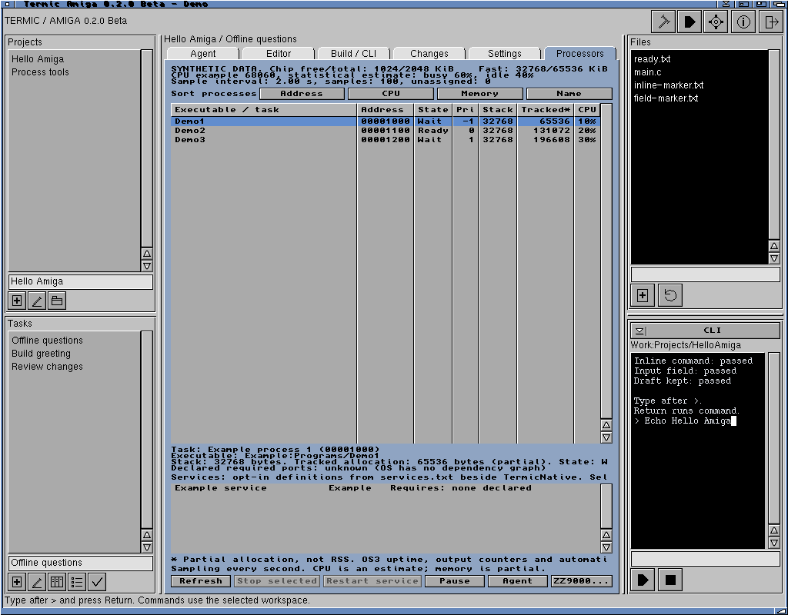
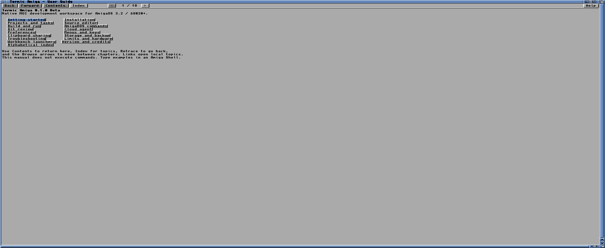
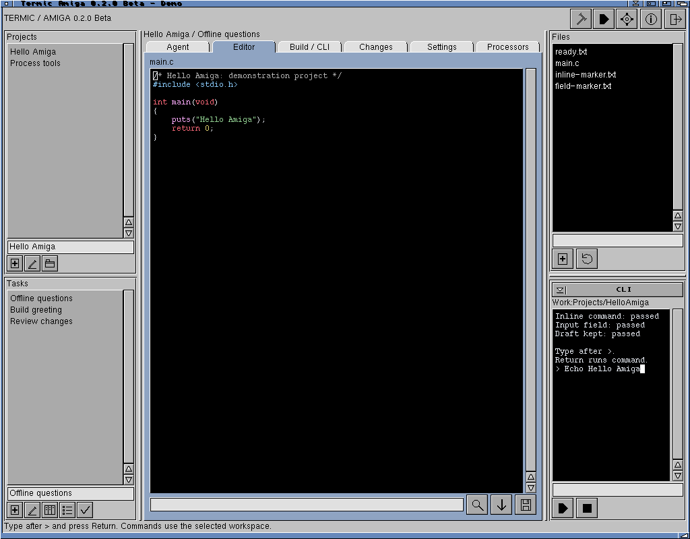
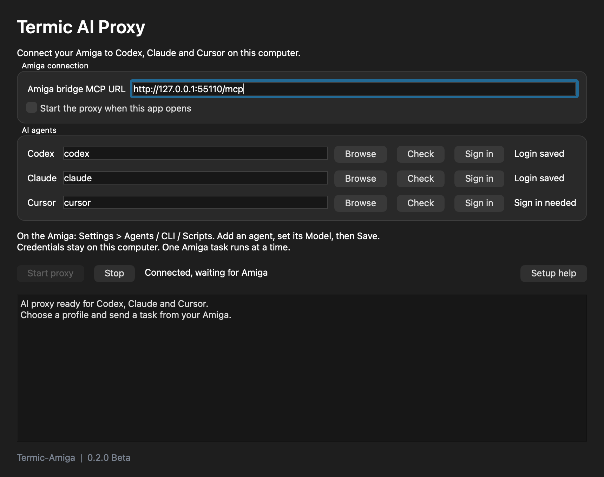

# Termic Amiga screenshots

The README gallery shows the production MUI widgets with synthetic demonstration
projects, task instructions, activity and process rows. The Mac Proxy image
uses its built-in demonstration mode. These images contain no account keys,
private projects or live process telemetry.

Reviewed README images live in `docs/screenshots/`, referenced through relative
paths. They are documentation only: never upload them to GitHub Releases or
copy them into installers, LHA archives, SDK staging or app bundles.
`.gitattributes` excludes this directory from future Git source archives.
Raw capture evidence stays in gitignored `.context/screenshots/` outside release
staging. See [release policy](releases.md).

## Reproduce the captures

Build `amiga/native/tests/test_gallery_window.c` with the production GUI units
and use the written `scripts/amiga/accept_gallery.py` suite with ChromeProbe.
It requires an idle target and reserves the shared gateway on port 55110.
Select screenshots using repeated `--only` arguments; omit them for the full
gallery. Output must be outside release staging. The fixture checks window
geometry, source preservation, Tiny selection and complete screenshot rows,
then closes its own window and releases the reservation.

For the Mac app, run the packaged executable with
`--screenshot-fixture /path/outside/release-staging/ai-proxy.png`.
Inspect every capture before copying it into `docs/screenshots/`; a passing
capture transfer alone does not prove text is visible or the layout is useful.

## Current source gallery

These Amiga captures were made on 22 November 2026 after the 0.2.0 Beta
release, including the shared-palette contrast fix. The Guide also shows the
new orange link labels and single-column contents. These features are included in 0.2.1 Beta; the captures retain the earlier
0.2.0 development-build title. The Mac image shows
the packaged 0.2.0 Beta proxy in demonstration mode.

### Editor, Files and CLI

### Agent activity and offline Tiny

### Kanban

### Integrated processors

### MUI Guide

Orange labels identify local links. On a full Workbench palette, MUI uses
the nearest available shared colour (amber/yellow in this capture), keeping
the links distinct from the light body text. Choose the matching related topic below
the text and press Open; the text area itself is read-only.

### CLI acceptance

The native fixture submitted commands from both input methods and checked
history protection, output updates and unsent draft preservation.

### Mac AI Proxy

