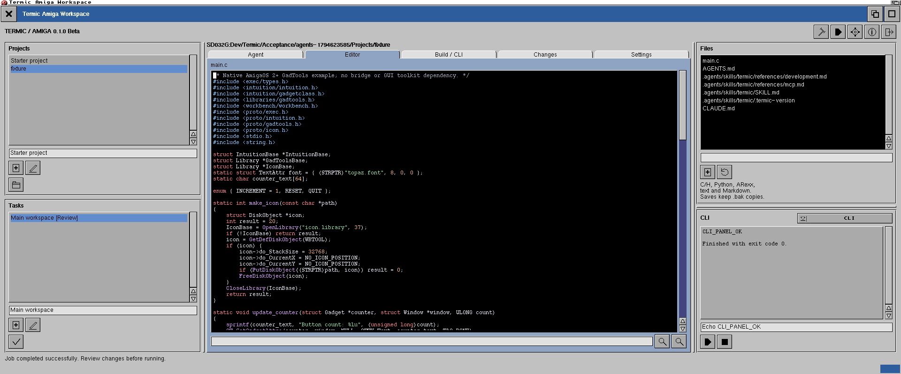

# Verification and limitations

The Amiga application was exercised on an A4000TX with a TF4060/68060,
Workbench 3.2.3, MUI 3.8 and subsequently MUI 5.0 (muimaster 21.227),
TextEditor.mcc 15.56, AmiSSL 5.27 and ZZ9000 RTG.
The screenshots show synthetic fixtures on that machine.

The earlier CLI/script update cross-built
for 68k and passed 11 portable test groups, including profile persistence,
credential separation, read-only API enforcement, MCP protocol handling and
filesystem boundaries. After a physical reboot, the written `accept_agents.py`
hardware suite passed profile Save/Use/Cancel, the MCP enable setting, task
creation, source writes, scratchpad round trips and traversal rejection.
The native command profile passed a worker-local environment value to AmigaDOS
Get. The host stdio connector completed initialization, listed all 15 tools and
called project_list through the real DevBench bridge and native TermicMCP.

Asynchronous MCP builds produced a native Hunk executable with VBCC on the Amiga.
An intentional compiler failure returned exit code 20 and left the previous
executable byte-for-byte intact. Tests use absolute SDK paths without changing
system compiler assigns. The final fixture closed normally, its public control
port disappeared, and original settings, assign and production window geometry
were restored. Screenshots show synthetic fixtures without API credentials.

An earlier test cleanup left an orphan window and stale control port; its cause
was not established. The test now closes through normal MUI events and checks
that the public port is removed. Task-list refresh notifications were also
corrected before the successful post-reboot runs. Authenticated API calls remain
unverified without a user key. Peer discovery, desktop pairing and automatic
client registration are not part of this native implementation.
The tested GUI, worker and TermicMCP were installed with a rollback backup.
The CLI/script update's CRC32 values are DEACE341, 6421F5AB and 920AB511 respectively;
the installed guide and changed source files also match the host copies.
The production window was restored to 1920 by 789 at (0, 11).
See [Agents and MCP](agents-and-mcp.md) for implemented features and limitations.

The CLI/script acceptance run also passed ARexx and MicroPython example scripts
through both saved launch profiles and the worker actions used by Build / CLI.
Each printed the expected output and returned exit code zero. The tested native
runtime identifies itself as MicroPython v1.28.0, build 239; its binary, license,
upstream README and pinned provenance accompany the installation.
ARexx used the system RX command and the already-running RexxMast.
MicroPython networking, TLS, third-party modules and interactive REPL behavior
have not been exercised by this suite. Script execution adds no new custom
Termic ARexx host commands. At that stage API/MCP writes were limited to C/H;
the instruction update also permitted reading six named project guidance files.
The agent execution update below supersedes that agent-file limitation.

Verified through the written hardware suites:

- Project/task creation, panel navigation, local compilation and program execution.
- Embedded editing, backup saves and exact plain-source export from coloured text.
- Local Git initialization, commits, status and diffs on an FFS long-filename image.
- Shell/build failure reporting and preservation of the previous executable.
- Quit/reopen with last-workspace restoration.
- About opening from the editor, closing/reopening, and all three Amiga version tags.
- Native menu order and command keys, ghosted Copy/Paste states, and menu shortcuts.
  Rechecked with menu-only editing controls, restored Helvetica/Courier fonts
  and framed sections; workspace, Settings and About screenshots were inspected.
- Clipboard output is an IFF FORM FTXT with the expected CHRS text; pasting into
  task instructions and saving produces exact plain text without colour codes.
- Preferences Use leaves saved defaults unchanged; Cancel discards edits; Save
  persists the restored effective values. Tests use synthetic models and no key.
- Help launches the 18-node AmigaGuide manual in MultiView; Shift-Help opens About.
  Keyboard link navigation reached the Installation and dependencies chapter.

After the MUI 5 upgrade, the same file/clipboard, preferences, About and Help
checks passed with `accept_style.py --mui-custom-menus`. MUI 5 did not expose
these menus through the Intuition MenuStrip inspected by the helper, so that
mode checks actual shortcut effects and explicitly records the menu-structure
inspection as untested. All GUI test launches use a 256 KiB stack.

The final production editor, preferences and About screenshots were inspected,
and the installed GUI, worker and guide matched host CRC32 checks. A subsequent
production Help launch stalled at MultiView’s “Loading…” window; its screenshot
request and a follow-up bridge request timed out. Production Help navigation
therefore still needs a repeat check, despite the fixture Help pass. The reboot
also exposed a separate MUI warning for Poseidon’s PoPo helper (8192-byte stack;
MUI recommends 32000); that system compatibility issue remains unresolved.

The `accept_style.py` suite uses a fresh temporary installation and restores the
previous clipboard and production app afterwards. Native menus were inspected
while MagicMenu and ToolsDaemon were already running. Mouse popup appearance and
new ToolsDaemon launcher entries have not been separately exercised.
Single-line MUI fields consume some application keys: Tab to a button or use the
mouse menus. Buttons in this setup activate with Return, not Space.

Portable checks validate the manual's node/link graph, packaging inclusion and
preference precedence alongside the existing protocol, agent, syntax and file tests.
See [Amiga interface conventions](amiga-interface.md) for the implemented scope.

The worker's stale-output regression failed before its fix and passed afterward.
Verified HTTPS returned the expected unauthenticated HTTP 401.
Authenticated cloud model/tool exchange has not been verified with a user key.

The existing long-filename image was prepared separately. Startup mounting and
refusal to recreate an active volume were exercised; automatic fresh-image
creation by `TermicStorage --create` has not been hardware-tested.
No ARM compute payload or firmware change is part of this application.
Automated checks and screenshots do not replace human interaction testing.

The API key is stored in plaintext in the local installation's Config drawer
and, when applied through preferences, in ENV:Termic until reboot.
It is excluded from this repository and installation kits. Source and requested
compiler output are sent to the selected cloud API when an agent runs.

The installed GUI, worker and guide were checked against the host-built files
using CRC32 after transfer. Previous executables and changed source files were
retained in the installation's Backup drawer before promotion.

## Custom title bar and Files list

The custom bar was built for 68020+ and exercised on MUI 5 on the A4000TX.
The written `accept_chrome.py` suite uses the same native window identifier as
`inspect_chrome.c` and tests Zoom/restore, title-bar dragging, grip resizing,
and Back/foreground restoration with actual injected input. Its optional final
step clicks X and checks that the window is gone. Host tests cover movement at
screen edges and resize limits, including a screen smaller than the minimum.
The Files list was visually inspected with light text on black.

Older native-title suites remain historical evidence for editor, clipboard and
preferences behaviour; their window-name guards are not compatible with the
new borderless main window. The custom bar has not been retested on MUI 3.8.
The existing Poseidon/MultiView issues above are not resolved by this change.

The title-bar icon update was rebuilt and passed the same hardware controls
suite, including X close, depth, zoom/restore, dragging and resizing. The compact
buttons use MUI custom Area drawings with explicit minimum/default/maximum sizes;
MUI supplies the frames and input handling. The final editor/preferences captures
were inspected after installation, and transferred executable/guide CRCs matched
the host files.

The resolution-scaled bar was rebuilt and passed the same hardware suite at
1920x800, including close. Its content height is now 26 rather than 32 pixels
at that resolution. Host tests cover the low-resolution minimum, 800/1080/1600
line sizes, the upper cap and invalid inputs. Other display resolutions have
not been exercised on the physical Amiga. Scaling uses the default public
screen height at launch; a resolution change requires restarting Termic.
The installed executable and guide matched host CRC32 checks. Editor and
preferences screenshots were inspected, and the user's maximized window
rectangle was restored after the windowed acceptance run.

## Prompt library, instructions, shortcuts and action icons

The combined update cross-builds for 68k and passes 14 portable groups. These
include shipped/default prompt resolution, edited/default separation across
updates, custom persistence, ordering, disable/delete state, invalid contents,
keyboard context boundaries, guidance serialization and MCP guidance file
copy/read/write restrictions. The skill template passes quick_validate.py.

The written accept_agents.py suite calls accept_workflow.py in its isolated
installation. The final A4000TX run passed:

- Installing guidance twice while preserving a project-owned AGENTS.md.
- Tab-to-send and Ctrl J in the prompt, with missing credentials stopping the
  request before network access; editor Tab does not launch another agent.
- Commands and keyboard-reference windows opening and closing.
- All 17 shipped prompts displayed; Review inserted without automatic send.
- Prompt Save, Use, duplicate, repeated reopening and Cancel after draft removal.
  Saving untouched defaults produces no overrides.
- Agent profile Save/Use/Cancel and MCP enable, through native icon controls.
- Native MCP task/file/scratchpad routines, traversal rejection, successful
  compilation, failed-build preservation, and host stdio transport.
- CLI environment inheritance, ARexx and MicroPython examples through profiles
  and worker command actions.
- Normal application close, public-port removal, and restoration of original
  ENV settings, Termic assign and 1920x789 production window geometry.

The final workspace, prompt library and shortcut screenshots were inspected.
The sidebar groups retain readable widths with compact icon actions. Tooltips
and descriptive menu commands accompany the icons. The prompt body is light
text on black. The screenshots contain synthetic task data and default prompt
examples, not findings from a review of the application.

A test exposed a queued List_Active refresh loop when reopening Prompts.
Notifications are now detached while rebuilding the list and reattached after
selection is restored; repeated reopen/save/cancel passed after the fix.
A title-bar key handler also ran after the active TextEditor handler; shortcuts
now register on the editor itself, with a main-window/focus guard.

Image paste, adjustable reasoning, subagent switching and custom keymaps remain
unavailable. Ctrl G opens the built-in editor. Shift Tab changes profiles.
Transcript search and selection use the native TextEditor widget; the suite
exercises transcript/search focus, not every scroll/selection combination or
physical-keyboard timing of double Escape. Cloud authentication is still not
verified with a real user key. The action icons have been tested on MUI 5 at
1920x800; other MUI versions and display resolutions need a separate check.

The verified build was installed with checksum verification for every promoted
file. Installed executable CRC32 values are EFC5E768 (GUI, 121848 bytes),
F62B6823 (worker, 63564 bytes), and 8726B98B (MCP, 58716 bytes). Previous files
are retained in SD032G:Dev/Termic/Backup/agents-1794598993. Missing project
instructions were installed while existing files were preserved. The production
application reopened successfully at 1920x789 with its control port present.

## Codex on Mac relay

Twenty portable test groups pass, including native relay frame ordering, stale
IDs, session validation, call limits, host mailbox ordering, stopped jobs,
read-only tool exposure, completion and resumption dispatch. All 68k binaries
cross-build. Codex CLI 0.166.0 reports ChatGPT authentication in the isolated
relay configuration; no API key or sign-in token was transferred to the Amiga.

The existing core hardware checks passed during the integrated runs: profiles,
prompts, shortcuts, native MCP, build/failure preservation, CLI, ARexx and
MicroPython. Relay failures were then narrowed with a focused rerun of the
written accept_codex.py checks in the same isolated installation. The final
relay checks passed on the A4000TX:

- The MUI composer launched the selected Codex on Mac profile with Tab.
- A real signed-in Codex turn listed/read source and guidance, wrote a small
  C89 console program, and compiled it with the native Amiga toolchain.
  The resulting Program has an Amiga Hunk header. The program was not run.
- A second turn resumed the saved thread and recalled the generated marker.
- Shift F10 stopped a worker waiting for the Mac without starting inference.
- Native read-only mode rejected write_source and build even when the test
  client explicitly requested them. Source bytes were preserved.
- A read_file request outside the task was rejected.
- The clipboard, ENV preferences, Termic assign and production window geometry
  were restored after the test.

Native probes exposed two compatibility issues. Append/update fopen modes
failed on this setup; the relay now uses bounded backup-and-replace transcript
writes, closing the file between messages. Long temporary mailbox names could
be created through stdio but failed native Rename with DOS error 205. A direct
long/short comparison confirmed shorter names work; all generated mailbox
filenames, including temporary suffixes, are now at most 30 characters.

The direct API branch still uses append-mode transcript output and needs a
separate repair/verification on this filesystem. The verified Codex relay does
not use that branch. Its completed-message display is not token streaming.
One relay task runs at a time. Live cancellation during inference/compiler
execution, disconnect/reboot recovery and different MUI/display configurations
remain additional hardware checks; stop-before-connection and portable
disconnection handling were exercised. No AmiPkg release was published.

Installed files were checksum-verified. GUI: 122308 bytes, CRC32 A4E31D38;
worker: 68832 bytes, B200C168; MCP: 58760 bytes, 3793A0B3. The rollback
backup is SD032G:Dev/Termic/Backup/agents-1794608665. The production app
reopened at 1920x789 with its control port present. The installed MCP handshake,
15-tool catalogue and disabled-by-default gate passed. The Mac launcher
uses an installed copy of the tested relay and passes the sign-in check.

## Desktop proxy, Claude and Cursor

The desktop proxy adds native profile kinds 6 and 7, provider-specific session
references, model arguments, a bounded stdio MCP adapter and cross-host file
transfers. The Mac GUI is bundled with Qt/Python; Windows uses the same source.
Portable tests include real stdio MCP communication, invalid client tokens,
read-only rejection, call limits, provider/model/resume routing, completed and
failed CLI responses, missing login cleanup and duplicate proxy locks.

A live Claude request was attempted. Its status command reported a saved
Claude.ai Pro login, but inference failed because that OAuth session could not
be refreshed. The user chose to finish without live Claude testing. Cursor's
CLI was installed but no authenticated Cursor request has passed. Neither
provider is claimed to have passed live cloud inference. The host status label
says Login saved because stored login state alone cannot establish live access.

The written `accept_providers` suite uses synthetic MCP clients against native
Amiga workers. It checks each provider/model request, C/H read/write, native
VBCC compilation, history resumption, read-only rejection and waiting-worker
Stop. This establishes the local tool path independently of cloud access.
The bundled smoke test checks Qt startup and actual executable-to-executable
MCP pipes; it does not authenticate to any model or contact the Amiga.

The Claude/Cursor hardware suite passed on the A4000TX with MUI 5, in the
isolated fixture agents-1794607649. It restored production at 1920 x 789.
Twenty-six host test groups passed. The macOS bundled GUI and stdio MCP smoke
test passed. Live inference for the two new providers remains unverified.

The packaged macOS application also passed written Start, Stop, restart and
window-close tests against a synthetic HTTP MCP bridge. These use actual
GUI button handlers and worker processes, with no cloud or Amiga dependency.

Both platform jobs in [desktop build 43522993207](https://github.com/SkiltonUSA/Termic-Amiga/actions/runs/43522993207)
passed their portable suite, packaging, bundled GUI/MCP smoke test and written
Start/Stop/restart/close test. Windows ran on a GitHub-hosted Windows runner;
a physical Windows 11 PC connected to this Amiga has not been tested.
The Windows artifact ZIP was downloaded and its integrity and executable /
_internal layout checked. No model credentials were used in CI.

The tested native build was installed with checksum verification and backup
at `SD032G:Dev/Termic/Backup/agents-1794610294`. GUI CRC32 4FBA275C,
worker 0EE89984, MCP B3344EDF. Installed MCP handshake, 15 tools and the
default-disabled gate passed. Production geometry and settings were restored.
The Mac desktop app was installed and its running relay connection verified.

## Proxy connection recovery

The installed proxy was subsequently found stopped with an opaque MCP
TaskGroup error. The original nested exception was not recorded, so its exact
cause is unknown. Transport failures now reconnect with bounded backoff and
show a readable status. Partially initialized MCP contexts are closed before
retry. The running proxy retains its consumed job ID across reconnects.
Regression tests cover failed initialization cleanup, interrupted-job replay
prevention, retry backoff, Stop during retry, lock release, fatal input errors,
HTTP status classification and an actual refused localhost connection.
The packaged GUI test now starts with an unavailable synthetic Amiga and
simulates a second disconnection after connecting, before Stop/restart/close.

All 18 portable proxy test groups passed after this change, as did the local
macOS bundled startup/MCP and expanded GUI connection-recovery tests.

[Recovery build 43526908696](https://github.com/SkiltonUSA/Termic-Amiga/actions/runs/43526908696)
passed on macOS and Windows, including the expanded packaged GUI recovery
checks. The installed Mac app was updated with a local backup and reconnected
to the actual Amiga bridge. The new Windows download passed archive integrity
checks. Claude and Cursor live authentication remains unverified.

## Claude subscription authentication completed

The user refreshed Claude's browser login. Claude Code then reported a
Claude.ai Pro login and passed a real model/MCP smoke test. The authenticated
Amiga acceptance subsequently passed GUI task submission, source reading and
writing, native compilation, conversation resume, Stop while waiting,
read-only enforcement and path-traversal rejection. The generated program was
compiled but not run. This supersedes the earlier expired-Claude-login result.
The live transcript recorded the actual read_source, write_source and build
calls. The resume check examines only the new turn's response text.

Claude emits the same session ID on many events. The relay now saves it once
per turn, avoiding redundant Amiga file writes, and rejects a changed ID
within a turn. A subprocess protocol regression test covers repeated IDs.
Cursor browser sign-in and authenticated Cursor execution remain pending.

[Session update build 43529096729](https://github.com/SkiltonUSA/Termic-Amiga/actions/runs/43529096729)
passed portable, packaged MCP and desktop lifecycle/recovery checks on macOS
and Windows. The updated Mac app was installed and restarted after restoring
the production Amiga workspace and removing the temporary helper. The Windows
archive was downloaded and integrity-checked. Cursor sign-in is still pending.

## Cursor subscription authentication completed

Cursor browser sign-in is now saved in the proxy's dedicated configuration.
The first authenticated smoke test exposed missing MCP discovery: the CLI
did not load the adapter from the custom CLI configuration directory.
Registering it in the dedicated workspace's `.cursor/mcp.json` fixed the
failure. The regression test checks discovery configuration at subprocess
launch and cleanup after both successful and failed turns.

The real Cursor smoke test then called list_sources successfully. On the
A4000TX, authenticated acceptance passed GUI submission, read_source,
write_source, native VBCC compilation, conversation resume, Stop while waiting,
native read-only enforcement and path-traversal rejection. The resulting
Hunk executable was compiled, not run. Settings, clipboard, assign and the
production window were restored. This supersedes the earlier pending-Cursor
results. All three host providers have now passed authenticated Amiga tests.

All 18 portable proxy tests, the rebuilt macOS GUI/MCP smoke test and packaged
connection-recovery/Start/Stop/restart/close checks passed. The Mac application
was backed up and updated with the MCP discovery fix.

[Cursor MCP build 43543665677](https://github.com/SkiltonUSA/Termic-Amiga/actions/runs/43543665677)
passed portable tests, packaging, bundled MCP and desktop lifecycle/recovery
checks on both macOS and Windows. A physical Windows 11 connection to this
Amiga remains untested.

## Persistent CLI beneath Files

The right sidebar now retains Files above a CLI panel with an adjustable
roughly half-height split. CLI, ARexx and MicroPython command entry stays
visible alongside the editor or agent view. The Build / CLI tab keeps the
larger mirrored job log. This is captured command execution, not a PTY for
interactive full-screen shell applications.

The focused written hardware acceptance passed on the A4000TX with the final
GUI and worker: Return-to-run, successful output, native exit code 20, output
replacement and clipboard copy, source staying visible, one character typed
exactly once, save/undo/save restoring the original source, and resizing from
1400x650 to 1920x789. The test restored the production preferences, clipboard,
assign and window. Both captured layouts were read back and inspected.

The run exposed and verified fixes for click-to-focus after TextEditor was
unlocked, saving an undo back to its original imported text, and completion
being published before buffered command output reached the log. The worker
now flushes output before publishing its result, and the GUI reads the log
once more after observing completion. All 33 portable tests and the final
68k cross-build passed.

The verified GUI and worker, matching sources, ReadMe and AmigaGuide were
installed after staging, checksumming and backing up the previous files.
Production reopened at 1920x789. Installed GUI: 123340 bytes, CRC32
`C4EC0264`; worker: 69284 bytes, CRC32 `820A3498`. The backup is
`SD032G:Dev/Termic/Backup/cli-panel-1794624848`.

## Live host-agent feedback

Codex, Claude and Cursor now forward buffered text deltas during generation.
Real authenticated smoke checks against a synthetic tool endpoint observed
396 Codex deltas, 180 Claude deltas and 460 Cursor deltas. Text reached the
mailbox before completion in all three cases, the start/end markers each
appeared exactly once, and each provider called list_sources. These smoke
checks validate real provider events; their tool endpoint uses synthetic
source data rather than the Amiga filesystem.

The portable suite passes 38 tests, including chunk batching, final-message
reconciliation, wrong-thread filtering, duplicate Cursor flushes, Claude text
versus tool/reasoning deltas, transport failure, buffer limits and tool ordering.
The standalone TextEditor native regression preserves a sentence split across
two inserts exactly.

Repeated live updates exposed a native reply-file publication failure. The
proxy now removes an acknowledged reply before publishing the next request,
so it does not poll an old reply during replacement. Native publication also
uses a shorter temporary basename: the stop-marker temporary filename had
exceeded the classic 30-byte filename limit. The mailbox order regression
checks that reply removal happens before each new request.

The written A4000TX acceptance passed with text visible while the worker
remained busy, exact joining across partial-text boundaries, stable clipboard
selection (including when the job completes), catch-up after selection
release, tool start/return markers and
final completion without duplication. Stop after partial output published its
marker successfully and rejected further text. Production settings, assign,
clipboard and window geometry were restored. The refreshed Mac bundle passed
GUI/MCP smoke and Start/Stop/reconnect/restart/close checks.

The final GUI and worker were installed with matching source files, ReadMe
and AmigaGuide, after staging and checksum verification. Installed GUI:
124144 bytes, CRC32 `4C9A117E`; worker: 69496 bytes, CRC32 `15796181`.
The rollback backup is
`SD032G:Dev/Termic/Backup/live-feedback-1794668662`. The production window
reopened at 1920x789, and the Mac proxy bundle was backed up and updated.
This supersedes the earlier completed-message-only display limitation.

[Live feedback build 43608154271](https://github.com/SkiltonUSA/Termic-Amiga/actions/runs/43608154271)
passed portable tests, packaging, bundled MCP and desktop lifecycle/recovery
checks on macOS and Windows. The Windows archive passed integrity and
executable/dependency-layout checks. A physical Windows 11 connection to the
Amiga remains untested.

## Agent execution and live hardware queries

The shared native dispatcher now provides system_info, run_arexx and
run_program for direct API and host-agent profiles. All 38 portable tests
passed, including read-only enforcement, tool schemas, ARexx file access,
path rejection, and build permission invalidation after edits or failures.
The worker, GUI and MCP programs cross-built for 68k. The Mac proxy bundle
passed its GUI and stdio MCP smoke test.

The written hardware acceptance passed ARexx output and syntax-error status,
native VBCC build-and-run, nonzero program exits, failed-build diagnostics,
preservation of the previous executable, refusal to run a stale build,
live hardware queries and cooperative Stop. Testing caught and corrected
RX treating a quoted filename as inline ARexx and the build script exiting
or losing its failure status before displaying compiler diagnostics.

Authenticated Codex acceptance then queried the actual hardware, wrote an
ARexx script containing the detected CPU and memory values, executed it,
and returned its output and exit code. This ran in an isolated fixture
through the real relay and existing host login. The test verifies the worker
log, saved script, transcript and completion status. No credentials were
copied to the Amiga.

At this stage the new execution tools had been exercised live with Codex.
Claude and Cursor shared the dispatcher and passed portable adapter tests;
the subsequent execution checks are recorded below.
Direct API execution and a physical Windows 11 connection remain untested.
See [Agent execution](agent-execution.md) for the synchronous run limits,
cooperative Stop and New conversation requirement after upgrading.

The subsequent `accept_build_agent.py` check used the installed worker and
an isolated C task. Authenticated Codex read the deliberately broken source,
received the real compiler failure, corrected the source, rebuilt and ran
Program exactly once. Native log ordering, captured output, exit code zero,
final source and the Hunk executable all passed verification. The Mac proxy
was restored after the check; existing user tasks were not edited.

All 17 shipped prompt introductions now describe ARexx execution, build/run
and hardware queries, with read-only restrictions. The eight native test
groups passed, including prompt limits and preservation of custom overrides.
The importer reproduced the updated defaults byte-for-byte from the desktop
source. User-customised prompts remain unchanged.

[Execution proxy build 43619273350](https://github.com/SkiltonUSA/Termic-Amiga/actions/runs/43619273350)
passed portable tests, packaging, bundled MCP smoke tests and desktop
lifecycle/recovery checks on both macOS and Windows. Download links are in
[AI Proxy setup](ai-proxy.md). This does not establish a physical Windows 11
to Amiga connection test.

## Session saving, Cursor operation polling and Stop cleanup

Long profile IDs could make a session filename and its temporary save share
one truncated 30-character name on the target filesystem. Such IDs now use a
short stable filename, with room for temporary and backup suffixes. Ordinary
short IDs retain their existing filenames. Boundary, provider-separation,
known-hash and replacement-save tests passed.

A live Cursor build check received MCP request timeouts and issued repeated
tool calls. Cursor now starts one native operation and collects its result
with `await_operation`, using polls of at most 20 seconds. Pending requests
return the existing operation ID. Completed results remain available for the
current task; poll cancellation does not cancel or repeat the native action.
Read-only restrictions and the native tool budget still apply. A provider
cannot finish successfully while its operation result remains uncollected.

Stopping the failed fixture exposed a second defect: the default VBCC
Ctrl-C handler could exit during file I/O without releasing worker resources.
A native control probe reproduced the abrupt exit; the replacement handler
latched cancellation and returned normally. The written Stop-during-build
acceptance then verified cancellation, exit status 20, and removal of both
public ports, the relay request and the task lock on the final worker.

All eight native test groups and 27 portable proxy tests passed, including
real stdio MCP polling, duplicate requests, cached results, cancelled polls,
read-only enforcement, task limits and cleanup. The rebuilt Mac bundle passed
GUI/MCP smoke tests and desktop reconnect, Start, Stop and close acceptance.

Authenticated Claude and Cursor then both passed the hardware-to-ARexx and
C repair/build/run checks using the final candidate worker. Each C check
required exactly one failed build, one repaired build and one execution.
Native logs, saved sources, captured output, Hunk headers and exit status were
verified independently of the model's report. Cursor completed operations
lasting longer than a minute by polling, with no repeated native builds or
executions. Temporary profiles were removed and original settings restored.
These checks supersede the earlier Claude/Cursor execution verification gap.
Direct API execution and a physical Windows 11 connection remain untested.

The verified native GUI, worker and MCP binaries, matching changed source
files, ReadMe and AmigaGuide were installed after checksum validation and a
rollback backup. The production window reopened with its control port active.
The installed worker is 76056 bytes, CRC32 `6C8D75FC`. Original Amiga profiles
were checked against their pre-test state; no fixture worker ports remained.
The Mac proxy was backed up, replaced with the tested bundle, and confirmed
ready with an idle relay.

[Provider reliability build 43630569708](https://github.com/SkiltonUSA/Termic-Amiga/actions/runs/43630569708)
passed portable tests, packaging, bundled MCP smoke tests and desktop
lifecycle/recovery checks on both macOS and Windows. Updated downloads are
linked in [AI Proxy setup](ai-proxy.md). The Windows archive passed integrity,
executable-header and bundled Python/Qt layout checks. Windows hardware
connectivity remains outside this automated verification.

## Packaged task pickup and bridge mailbox recovery

A subsequent production task timed out waiting for the host before any
provider connection or native tool action. Earlier authenticated hardware
checks dispatched jobs from the source helper; the packaged desktop checks
covered connection lifecycle but did not exercise pending task pickup.

The shell-based existence check could receive a capture filename or an
unrelated bridge error. It has been replaced with validated directory and
file operations. A two-client read control failed with the old transport;
all 20 reads passed with the replacement. A separate native-file probe
verified checksum, publication, readback and deletion. Reading a running
worker's exclusively opened log also reproduced an unrelated READFILE error
interrupting CHECKSUM. Only read-only verification is retried, never the
write, rename or native execution.

The packaged acceptance now presents an actual synthetic request through
MCP, injects malformed directory and unrelated checksum replies, verifies
ordered acknowledgements, and requires the packaged worker to report a
missing provider executable back to the simulated Amiga. This needs no
account or model access and runs in both desktop CI jobs. All 35 portable
proxy tests passed locally. Native binaries are unchanged by this fix.

The reported production task then passed through the installed Mac app's
normal idle mailbox pickup. The previous conversation and transcript were
backed up; a fresh conversation loaded the current native tool schema.
Hardware detection, source save and exactly one ARexx execution completed
with captured output and exit status 0. The earlier transcript remained
intact. This exercises the previously missing packaged-app-to-hardware path.
Private task contents and hardware transcripts are not public fixtures.

The final installed Mac bundle matches the tested build. The app is running,
the production task is in Review with exit status 0, its lock is gone, the
relay is idle, and the native GUI remains active. The worker checksum is
unchanged. [Mailbox recovery build 43641003631](https://github.com/SkiltonUSA/Termic-Amiga/actions/runs/43641003631)
passed all 35 proxy tests, packaging, bundled MCP smoke, packaged mailbox
acceptance and desktop lifecycle checks on macOS and Windows. The current
downloads are linked in [AI Proxy setup](ai-proxy.md). A physical Windows 11
to Amiga connection remains untested.

## Activity follows the latest line

The activity viewport used a conditional follow check and mixed TextEditor
pixel positions with line counts. Replacing content could leave the cursor
at the start, allowing a subsequent show/layout to return there. Activity
now moves the cursor to EOF and asks TextEditor to reveal it after loading,
appending or replacing content, and after the initial window opens. Selected
text still holds incoming updates until the selection is released. Typing
focus is not moved away from the input field.

The synthetic native MUI regression in `test_activity_scroll.c` checks long
content loading, following after manual scroll-up with an unchanged cursor,
appending, replacement, reopening, input focus preservation and short text.
It runs through `accept_activity_scroll.py` without opening production task
files or changing settings. The eight portable native test groups passed.
The GUI and regression probe cross-compiled with VBCC.

All native scroll checks passed on the Amiga's installed MUI/TextEditor
classes. The tested GUI, matching sources, ReadMe and AmigaGuide were
installed after staging, checksum verification and a rollback backup.
The GUI is 126304 bytes, CRC32 `A694DF95`. Production reopened at its original
window geometry and AI Proxy was restarted. No worker or proxy code changed.
